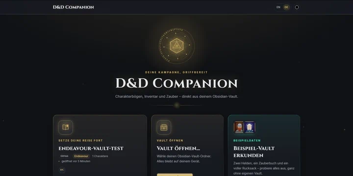

<div align="center">

<picture>
  <source media="(prefers-color-scheme: dark)" srcset="docs/logo-dark.svg">
  
</picture>

# D&D Companion

**A D&D character sheet that lives inside your Obsidian vault, and at your Owlbear Rodeo table.**

Point it at your vault, a folder on your device or your group's GitHub repository,<br>
and your characters, items and spells turn into an interactive sheet.<br>
No server · no database · no account.

[](https://walsplitter.github.io/dnd-companion-web/)
[](https://github.com/WalSplitter/dnd-companion-web/wiki)

[](LICENSE)




</div>

## Features

- 🎲 **A living sheet.** Modifiers, saves, skills and spell DC are derived, never duplicated. Click any value like `1d8` or `2d6+3` to roll it; a roll log keeps the session's rolls and sets advantage on touch screens.
- 🎒 **Slot-grid inventory.** Drag items between backpacks and pouches, track charges, and equip gear on a character screen with body slots.
- ✨ **Spells and resources.** Slots, mana, class pools, luck points, exhaustion, rests and a biography tab.
- 🌳 **Skill tree.** The class from level 1 to 20 as a talent board, built from the class table in your vault.
- 📖 **Journal and campaign log.** Players take notes per character; the DM keeps quests, people and places for the whole party.
- 📜 **Reads your vault directly.** Frontmatter and `[[Wikilinks]]`, with hover previews like in Obsidian.
- 💾 **Writes back safely.** Edits are patched into the exact YAML key; formatting and comments stay. Failed writes are rolled back.
- ☁️ **Straight from GitHub.** On any device, phones included, saved as tidy commits, with a chronicle of every session.
- 📴 **Works offline.** Installable as a PWA; edits wait and are committed once you're back online.
- 🏰 **In Owlbear Rodeo.** HP, temp HP, resilience and AC of linked tokens are live for the whole group, in sync with the Clash! tracker; rolls show up on the token.
- 👥 **The whole party.** Cards, a compact list or a front/middle/back lineup, plus a side-by-side comparison.
- 🎨 **Yours to style.** Colour palettes, class and animated topic themes; English and German.

## Quick start

Open **<https://walsplitter.github.io/dnd-companion-web/>**. There is nothing to install. Then pick a card on the start page:

| | Card | Where the vault is | Saving changes |
| --- | --- | --- | --- |
| 🧪 | **Explore the sample vault** | bundled demo party of seven | tried in memory, never saved |
| 📁 | **Choose folder…** | a folder on your device | into the files (Chrome, Edge, Opera) |
| ☁️ | **Open from a repository** | a GitHub repository | as commits, in any browser |

Your vault is read in the browser and not uploaded anywhere. Saving to a folder needs the [File System Access API](https://developer.mozilla.org/en-US/docs/Web/API/File_System_API), so Firefox and Safari open folders read-only; GitHub vaults work everywhere.

## Documentation

The [wiki](https://github.com/WalSplitter/dnd-companion-web/wiki) has step-by-step guides for players and DMs:

| Guide | What's in it |
| --- | --- |
| [Getting Started](https://github.com/WalSplitter/dnd-companion-web/wiki/Getting-Started) | from zero to your character sheet in a few minutes |
| [Journal](https://github.com/WalSplitter/dnd-companion-web/wiki/Journal) · [Campaign Log](https://github.com/WalSplitter/dnd-companion-web/wiki/Campaign-Log) | notes per character, and the DM's log for the whole party |
| [Skill Tree](https://github.com/WalSplitter/dnd-companion-web/wiki/Skill-Tree) | the class progression board and the level table behind it |
| [GitHub Sync](https://github.com/WalSplitter/dnd-companion-web/wiki/GitHub-Sync) | repository setup, access tokens, commits, offline use and the chronicle |
| [Owlbear Rodeo](https://github.com/WalSplitter/dnd-companion-web/wiki/Owlbear-Rodeo) | the extension, live values, Clash!, rolls on the token |
| [Vault Setup](https://github.com/WalSplitter/dnd-companion-web/wiki/Vault-Setup) · [For the DM](https://github.com/WalSplitter/dnd-companion-web/wiki/For-the-DM) | characters, items, spells and classes in your vault |
| [Vault Formats](https://github.com/WalSplitter/dnd-companion-web/wiki/Vault-Formats) | the exact frontmatter of the native, Endeavour and legacy formats |
| [FAQ and Troubleshooting](https://github.com/WalSplitter/dnd-companion-web/wiki/FAQ-and-Troubleshooting) | when something doesn't work |

## Owlbear Rodeo

In Owlbear Rodeo, open **Extensions → Manage Extensions → Add custom extension**, enter

```
https://walsplitter.github.io/dnd-companion-web/owlbear-manifest.json
```

and turn it on for your room. A **d20** in the toolbar opens the companion next to the map. How linking tokens, live values and Clash! work is in the [wiki](https://github.com/WalSplitter/dnd-companion-web/wiki/Owlbear-Rodeo).

## Development

Requires [Node.js](https://nodejs.org) 20+.

```bash
git clone https://github.com/WalSplitter/dnd-companion-web.git
cd dnd-companion-web
npm install
npm run dev      # http://localhost:5173
```

`npm run build` type-checks and builds, `npm run test` runs Vitest, `npm run lint` runs oxlint. Every push to `main` redeploys GitHub Pages. Architecture, local Owlbear testing and self-hosting are covered in [Development](https://github.com/WalSplitter/dnd-companion-web/wiki/Development).

## Roadmap

Planned work is tracked in [GitHub issues](https://github.com/WalSplitter/dnd-companion-web/issues), for example [#9](https://github.com/WalSplitter/dnd-companion-web/issues/9) (AC, initiative and spell DC by the Nimble formulas in Endeavour).

## License

[MIT](LICENSE)
